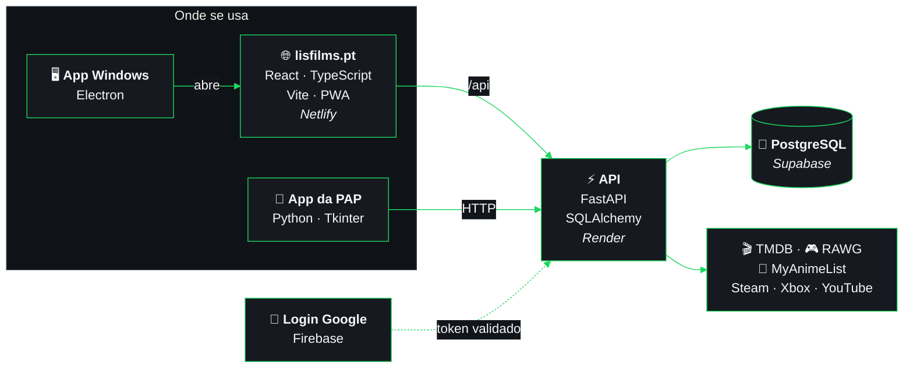

<div align="center">



<br>

<a href="https://www.linkedin.com/in/thiago-anjos-b50628376/"></a>
<a href="https://lisfilms.pt"></a>
<a href="https://github.com/thiagodanjos/lissecurity"></a>


</div>

<br>

Sou o **Thiago Anjos**, estudante de **Desenvolvimento Web e Multimédia** em Leiria. Gosto de levar
uma ideia até ao fim: base de dados, API, interface, testes automáticos e publicação. Foi assim que
nasceram os projetos da família **Lis**: uma rede social em produção, um cofre de senhas com
criptografia moderna e um gestor de servidores Discord que não precisa de alojamento.



<details>
<summary><b>🗺️ Ver o caminho no mapa</b> (interativo: arrasta e faz zoom)</summary>
<br>

```geojson
{
  "type": "FeatureCollection",
  "features": [
    {
      "type": "Feature",
      "properties": {
        "title": "Mogi das Cruzes, São Paulo, Brasil",
        "description": "Onde nasci e cresci",
        "marker-color": "#1ed760",
        "marker-size": "large"
      },
      "geometry": {
        "type": "Point",
        "coordinates": [-46.1854, -23.5225]
      }
    },
    {
      "type": "Feature",
      "properties": {
        "title": "Leiria, Portugal",
        "description": "Onde vivo desde os 11 anos e estudo Desenvolvimento Web e Multimédia",
        "marker-color": "#1ed760",
        "marker-size": "large"
      },
      "geometry": {
        "type": "Point",
        "coordinates": [-8.8071, 39.7436]
      }
    },
    {
      "type": "Feature",
      "properties": {
        "title": "A grande mudança",
        "description": "Cerca de 8 000 km, de Mogi das Cruzes a Leiria",
        "stroke": "#1ed760",
        "stroke-width": 3,
        "stroke-opacity": 0.9
      },
      "geometry": {
        "type": "LineString",
        "coordinates": [[-46.1854, -23.5225], [-45.2312, -21.9455], [-44.2979, -20.3631], [-43.3836, -18.7758], [-42.4864, -17.1842], [-41.6045, -15.5887], [-40.7363, -13.9897], [-39.88, -12.3877], [-39.0342, -10.7831], [-38.1974, -9.1761], [-37.3681, -7.5673], [-36.545, -5.9569], [-35.7267, -4.3453], [-34.9119, -2.7328], [-34.0993, -1.1198], [-33.2876, 0.4935], [-32.4755, 2.1067], [-31.6617, 3.7194], [-30.8449, 5.3314], [-30.0239, 6.9423], [-29.1972, 8.5518], [-28.3634, 10.1595], [-27.5213, 11.7651], [-26.6693, 13.3682], [-25.8058, 14.9684], [-24.9294, 16.5653], [-24.0384, 18.1585], [-23.1309, 19.7475], [-22.2053, 21.3318], [-21.2594, 22.911], [-20.2913, 24.4844], [-19.2988, 26.0515], [-18.2793, 27.6117], [-17.2305, 29.1641], [-16.1496, 30.7082], [-15.0336, 32.243], [-13.8794, 33.7677], [-12.6835, 35.2812], [-11.4422, 36.7825], [-10.1515, 38.2704], [-8.8071, 39.7436]]
      }
    }
  ]
}
```

</details>

<br>

## 🍿 Em cartaz

<table>
<tr>
<td width="33%" align="center" valign="top"><a href="https://lisfilms.pt"></a></td>
<td width="33%" align="center" valign="top"><a href="https://github.com/thiagodanjos/lissecurity"></a></td>
<td width="33%" align="center" valign="top"><a href="https://github.com/thiagodanjos/lisdiscord"></a></td>
</tr>
<tr>
<td valign="top">
<b>A rede social para quem vê filmes, séries e animes, e para quem joga.</b>
Reviews, listas, maratonas, grupos e o hub de jogos LisGames. React, FastAPI e PostgreSQL;
começou como a minha PAP e está em produção.
<br><br>
<a href="https://lisfilms.pt"></a>
<a href="https://thiagodanjos.github.io/lisfilms-demo/"></a>
</td>
<td valign="top">
<b>Cofre de senhas e dados bancários para Windows.</b>
Cifrado no teu PC com Argon2id e XChaCha20-Poly1305, núcleo em Rust, códigos 2FA e cópias no
Google Drive. Sem conta e sem internet.
<br><br>
<a href="https://github.com/thiagodanjos/lissecurity/releases/latest"></a>
<a href="https://github.com/thiagodanjos/lissecurity"></a>
</td>
<td valign="top">
<b>Gestão de servidores Discord a partir do PC.</b>
Backups e restauro seletivo, moderação, sorteios e 14 mini-jogos com economia de moedas, com um
bot próprio e sem alojamento.
<br><br>
<a href="https://github.com/thiagodanjos/lisdiscord"></a>
<a href="https://github.com/thiagodanjos/lisdiscord/releases/latest"></a>
</td>
</tr>
</table>

<details>
<summary><b>🧩 Como o LisFilms funciona por dentro</b> (diagrama interativo)</summary>
<br>



</details>

<br>

## 🛠️ Ferramentas



<br>

## 📊 Atividade no GitHub



<br>



<div align="center">

<a href="https://www.linkedin.com/in/thiago-anjos-b50628376/"></a>

</div>
