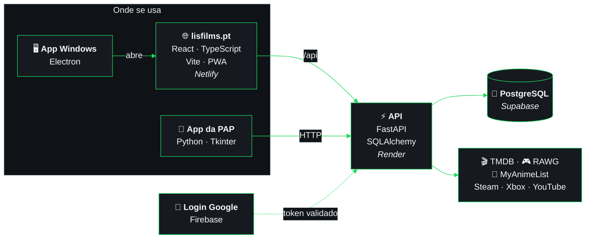

<div align="center">


<br />

<a href="https://www.linkedin.com/in/thiago-anjos-b50628376/"></a>
<a href="https://lisfilms.pt"></a>
<a href="https://thiagodanjos.github.io/lisfilms-demo/"></a>


</div>

<br>

## 👋 Olá, sou o Thiago

Nascido e criado em **Mogi das Cruzes, São Paulo, Brasil**, vim para **Leiria, Portugal** aos 11 anos de idade, e já lá vão 8 anos desde essa grande mudança.
**Estudante de Desenvolvimento Web e Multimédia, em Portugal**,
a construir aplicações completas, do backend à interface, e a aprender algo novo em cada projeto.

<details>
<summary><b>🗺️ De Mogi das Cruzes a Leiria</b> · abre o mapa interativo (dá para arrastar e fazer zoom)</summary>
<br>

```geojson
{
  "type": "FeatureCollection",
  "features": [
    {
      "type": "Feature",
      "properties": {
        "title": "Mogi das Cruzes, São Paulo, Brasil",
        "description": "Onde nasci e cresci",
        "marker-color": "#1ed760",
        "marker-size": "large"
      },
      "geometry": {
        "type": "Point",
        "coordinates": [-46.1854, -23.5225]
      }
    },
    {
      "type": "Feature",
      "properties": {
        "title": "Leiria, Portugal",
        "description": "Onde vivo desde os 11 anos e estudo Desenvolvimento Web e Multimédia",
        "marker-color": "#1ed760",
        "marker-size": "large"
      },
      "geometry": {
        "type": "Point",
        "coordinates": [-8.8071, 39.7436]
      }
    },
    {
      "type": "Feature",
      "properties": {
        "title": "A grande mudança",
        "description": "Cerca de 8 000 km, de Mogi das Cruzes a Leiria",
        "stroke": "#1ed760",
        "stroke-width": 3,
        "stroke-opacity": 0.9
      },
      "geometry": {
        "type": "LineString",
        "coordinates": [[-46.1854, -23.5225], [-45.2312, -21.9455], [-44.2979, -20.3631], [-43.3836, -18.7758], [-42.4864, -17.1842], [-41.6045, -15.5887], [-40.7363, -13.9897], [-39.88, -12.3877], [-39.0342, -10.7831], [-38.1974, -9.1761], [-37.3681, -7.5673], [-36.545, -5.9569], [-35.7267, -4.3453], [-34.9119, -2.7328], [-34.0993, -1.1198], [-33.2876, 0.4935], [-32.4755, 2.1067], [-31.6617, 3.7194], [-30.8449, 5.3314], [-30.0239, 6.9423], [-29.1972, 8.5518], [-28.3634, 10.1595], [-27.5213, 11.7651], [-26.6693, 13.3682], [-25.8058, 14.9684], [-24.9294, 16.5653], [-24.0384, 18.1585], [-23.1309, 19.7475], [-22.2053, 21.3318], [-21.2594, 22.911], [-20.2913, 24.4844], [-19.2988, 26.0515], [-18.2793, 27.6117], [-17.2305, 29.1641], [-16.1496, 30.7082], [-15.0336, 32.243], [-13.8794, 33.7677], [-12.6835, 35.2812], [-11.4422, 36.7825], [-10.1515, 38.2704], [-8.8071, 39.7436]]
      }
    }
  ]
}
```

</details>

<br>

## 🎓 Formação

| | |
|---|---|
| **Atual** | TeSP em Desenvolvimento Web e Multimédia - Universidade de Leiria e Oeste |
| **Concluído** | Curso Profissional de Técnico de Gestão e Programação de Sistemas Informáticos |

<br>

## 🍿 Em cartaz

<p align="center">
  <a href="https://lisfilms.pt"></a>
  <a href="#-lissecurity"></a>
  <a href="https://github.com/thiagodanjos/lisdiscord"></a>
</p>
<p align="center"><sub>Cada cartaz é clicável.</sub></p>

### 🎬 LisFilms

A tua rede social de filmes, séries, animes e jogos: reviews, feed social, watchlist, coleções e maratonas, grupos e mensagens, prémios da comunidade e um hub de jogos próprio (rankings, troféus, LisGaming Wrapped). App desktop (Python + Tkinter), backend próprio (FastAPI + PostgreSQL) e versão web (React), com integração com a API da TMDB. Desenvolvido como Prova de Aptidão Profissional (PAP), o maior projeto que já construí sozinho.

<div align="center">

[](https://lisfilms.pt)
[](https://thiagodanjos.github.io/lisfilms-demo/)

</div>

O código da versão em produção é privado; a **[demo pública](https://github.com/thiagodanjos/lisfilms-demo)**, feita para portefólio, está disponível para consulta.

<details>
<summary><b>🧩 Como o LisFilms funciona por dentro</b> · diagrama interativo</summary>
<br>



</details>

### 🔐 LisSecurity

Cofre pessoal para senhas, dados bancários, cartões, notas seguras e códigos 2FA: uma app para Windows que funciona **sem internet**. Tudo é cifrado no próprio PC com **Argon2id** e **XChaCha20-Poly1305**, num núcleo em **Rust** sem código `unsafe`, com uma interface **Tauri + React** com a identidade do LisFilms. Bloqueia sozinho (inatividade, minimizar, suspensão, Win+L), limpa a área de transferência, faz cópias de segurança cifradas para o Google Drive e mostra os gastos a partir de extratos do banco, tudo guardado dentro do cofre.

<details>
<summary><b>🔍 O que tem por dentro</b></summary>
<br>

- Chave do cofre aleatória, protegida pela senha mestra (Argon2id calibrado no próprio PC) e, se quiseres, por uma chave de recuperação de 160 bits
- Formato de ficheiro versionado e autenticado; gravação atómica, relida e verificada antes de substituir a anterior
- A interface só recebe vistas mascaradas: os segredos ficam no processo em Rust e são apagados da memória (`zeroize`)
- Gerador de senhas e frases-senha, deteção de senhas fracas e reutilizadas, códigos 2FA ao vivo (RFC 6238)
- Importação de senhas (Chrome, Edge, Firefox, Bitwarden…) e de extratos (Revolut ou CSV genérico)
- Testes unitários, de aceitação e ponta-a-ponta na app real a cada alteração
- Ainda sem auditoria de segurança independente

</details>

O código é privado.

### 🤖 LisDiscord

App desktop de backup, restauro e gestão de servidores Discord com um bot próprio, sem hosting nem servidor externo. Backup/restauro seletivo de cargos, canais e permissões, agendamentos automáticos, comparação entre backups, moderação (banir, expulsar, mutar, bloquear canais), mensagens com embeds, sorteios, um sistema de pontos de Mov. Call com painel ao vivo, e 14 mini-jogos (trivia, forca, blackjack, jogo do galo, duelo, roleta, caça-níqueis, corrida e mais) com uma economia de moedas partilhada por servidor.

<div align="center">

[](https://github.com/thiagodanjos/lisdiscord)
[](https://github.com/thiagodanjos/lisdiscord/releases/latest)

</div>

<br>

## 🛠️ Tecnologias


<br>

## 📊 Estatísticas


> Este painel é gerado aqui mesmo, todos os dias, por um GitHub Action ([`scripts/perfil.py`](scripts/perfil.py)) com dados da API do GitHub. Já não depende de serviços externos que ficam em baixo.

<br>


<div align="center">

📫 Contacta-me pelo **[LinkedIn](https://www.linkedin.com/in/thiago-anjos-b50628376/)**

</div>
